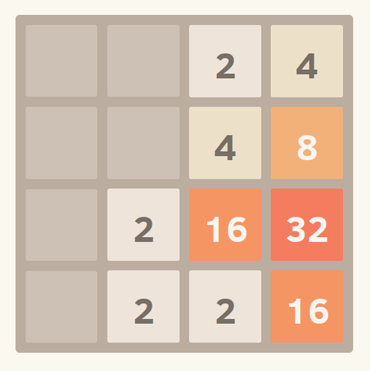

<!---
This file was generated from `meta.yml`, please do not edit manually.
Follow the instructions on https://github.com/coq-community/templates to regenerate.
--->
# T2048

[![Docker CI][docker-action-shield]][docker-action-link]

[docker-action-shield]: https://github.com/thery/T2048/actions/workflows/docker-action.yml/badge.svg?branch=master
[docker-action-link]: https://github.com/thery/T2048/actions/workflows/docker-action.yml


# T2048
a version of the 2048 game for Rocq



## Meta

- Author(s):
  - Laurent Théry
- License: [MIT License](LICENSE)
- Additional dependencies: none
- Rocq/Coq namespace: `T2048`
- Related publication(s): none

## Building and installation instructions

To build and install manually, you need to make sure that all the
libraries this development depends on are installed.  The easiest way to do that
is still to rely on opam:

``` shell
git clone https://github.com/thery/T2048.git
cd T2048
opam repo add rocq-released https://rocq-prover.org/opam/released
opam install --deps-only .
make   # or make -j <number-of-cores-on-your-machine> 
make install
```


